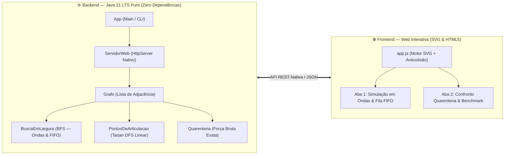
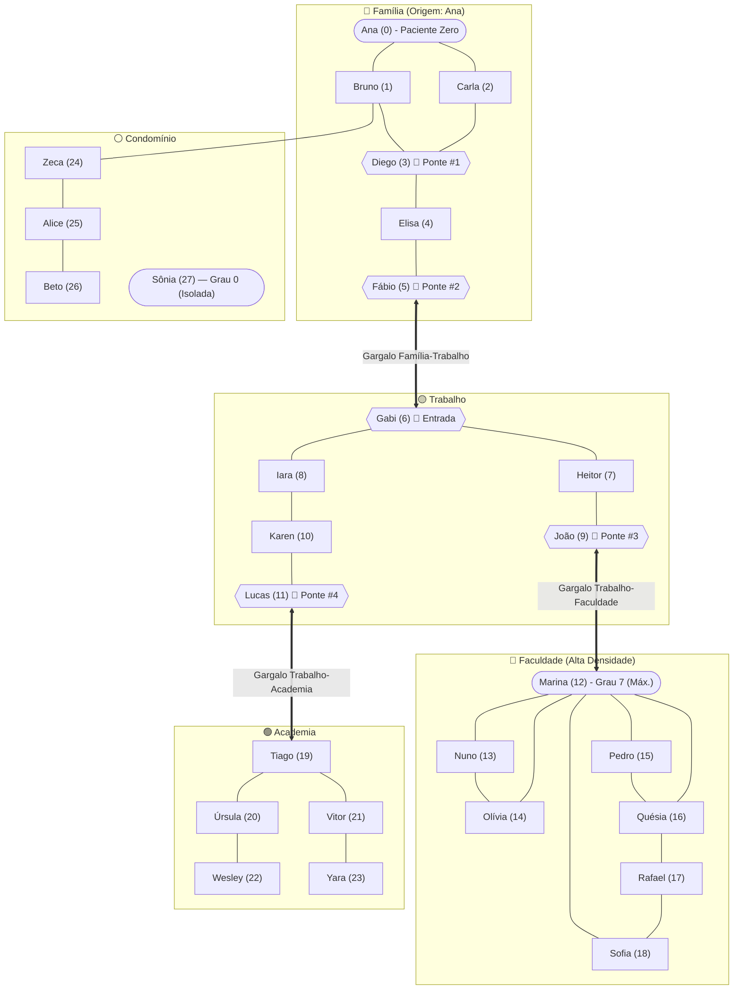

<div align="center">

# 🕸️ Caso Fake News — Propagação e Contenção em Redes Sociais com Teoria dos Grafos

**Modelagem Matemática, Algoritmos de Travessia (BFS/DFS), Pontos de Articulação de Tarjan e Quarentena Preventiva em Java 21 Puro**

[](https://adoptium.net/)
[](./demo/src/br/maua/fakenews/algoritmos/)
[-16A34A?style=for-the-badge)](./demo/)
[](https://maua.br/)

<br/>



<p align="center">
  <em>Arquitetura <b>"O Java 21 pensa, o navegador desenha"</b>: motor algorítmico de alto desempenho 100% em Java nativo e interface web interativa em SVG/HTML5 com física de relaxamento anticolisão.</em>
</p>

</div>

---

## 📌 Sobre o Projeto

Este repositório contém a pesquisa matemática, o modelo computacional e a aplicação interativa desenvolvidos para a disciplina **ECM306 — Tópicos Avançados de Estrutura de Dados** do **Instituto Mauá de Tecnologia (IMT)**.

Em vez de abordar aplicações tradicionais de rotas de GPS, o projeto investiga um problema contemporâneo de segurança da informação e dinâmica social: **como a topologia de uma rede de mensagens instantâneas governa a velocidade de difusão de um boato (*fake news*) e qual indivíduo deve ser colocado preventivamente em quarentena para maximizar a proteção da rede**.

### 🎯 Principais Descobertas Experimentais

1. **Popularidade local não equivale a importância estrutural:** Bloquear a pessoa mais conectada da rede (**Marina**, grau $7$, grupo *Faculdade*) protege **exatamente $0$ pessoas adicionais ($0\%$)**, pois seu grupo comunitário possui rotas internas redundantes (ciclos) que contornam o isolamento.
2. **Pontos de Articulação dominam a contenção:** Bloquear **Diego** (grau $5$) ou **Fábio** (grau $3$) — identificados em tempo linear $\mathcal{O}(|V| + |E|)$ pelo **Algoritmo de Tarjan** como *Pontos de Articulação* (pontes estruturais entre grupos) — interrompe o fluxo entre agrupamentos sociais e salva até **$20$ pessoas ($74,1\%$ da rede contaminada)**.
3. **Escalabilidade com Zero Dependências:** Implementado com estruturas de dados fundamentais (listas de adjacência com arrays primitivos), o algoritmo exato de Quarentena por Força Bruta $\mathcal{O}(|V| \cdot (|V| + |E|))$ analisa redes comunitárias sintéticas de **$2.000$ vértices e $4.433$ arestas em apenas $275,7\text{ ms}$ ($< 0,3\text{ s}$)**.

---

## 🧠 Modelagem em Grafo (As 5 Perguntas de Projeto)

Seguindo a metodologia de modelagem da disciplina, o problema foi estruturado formalmente como um grafo simples $G = (V, E)$:

1. **Quem são os vértices ($V$)?**
   Cada vértice representa um usuário cadastrado ([`pessoas.csv`](./demo/dados/pessoas.csv)). A rede principal possui $|V| = 28$ pessoas distribuídas em **5 grupos comunitários**:
   * 🔴 **Família** ($6$ membros: `Ana`, `Bruno`, `Carla`, `Diego`, `Elisa`, `Fábio`)
   * 🟡 **Trabalho** ($6$ membros: `Gabi`, `Heitor`, `Iara`, `João`, `Karen`, `Lucas`)
   * 🔵 **Faculdade** ($7$ membros: `Marina`, `Nuno`, `Olívia`, `Pedro`, `Quésia`, `Rafael`, `Sofia`)
   * 🟢 **Academia** ($5$ membros: `Tiago`, `Úrsula`, `Vitor`, `Wesley`, `Yara`)
   * ⚪ **Condomínio** ($4$ membros: `Zeca`, `Alice`, `Beto` e o vértice isolado `Sônia`, grau $0$)

2. **Quem são as arestas ($E$)?**
   Cada aresta $\{u, v\}$ representa um canal de contato direto mútuo entre dois usuários ([`contatos.csv`](./demo/dados/contatos.csv)), totalizando $|E| = 42$ conexões ativas.

3. **Direcionado ou Não Direcionado?**
   **Não direcionado**, pois o canal direto de mensagens instantâneas permite tráfego bidirecional ($u \leftrightarrow v$).

4. **Ponderado ou Não Ponderado?**
   **Não ponderado**: cada transmissão consecutiva representa $1$ salto discreto de contágio ($1$ onda de transmissão da BFS).

5. **Estrutura de Dados e Algoritmos:**
   Representação compacta em **Lista de Adjacência** ($\mathcal{O}(|V| + |E|)$ na classe [`Grafo.java`](./demo/src/br/maua/fakenews/modelo/Grafo.java)), combinando:
   * **Busca em Largura (BFS — $\mathcal{O}(|V| + |E|)$):** Simulação das ondas concêntricas de contágio com fila FIFO e rastreamento de predecessores ([`BuscaEmLargura.java`](./demo/src/br/maua/fakenews/algoritmos/BuscaEmLargura.java)).
   * **Quarentena Exata por Força Bruta ($\mathcal{O}(|V| \cdot (|V| + |E|))$):** Remoção hipotética de cada candidato $v \in V \setminus \{s\}$ seguida de BFS para mensurar a redução estrita do contágio global ([`Quarentena.java`](./demo/src/br/maua/fakenews/algoritmos/Quarentena.java)).
   * **Pontos de Articulação de Tarjan ($\mathcal{O}(|V| + |E|)$):** Algoritmo linear baseado em busca em profundidade (DFS) com vetores de descoberta (`disc`) e menor ancestral alcançável (`low`), detectando gargalos estruturais ([`PontosDeArticulacao.java`](./demo/src/br/maua/fakenews/algoritmos/PontosDeArticulacao.java)).

---

## 🗺️ Topologia da Rede e Pontes Críticas

A rede social modelada é organizada em torno de agrupamentos densos (*clusters*) conectados por poucos nós de transição (*pontes estruturais*):



---

## 📊 Resultados Experimentais: Heurística Gulosa vs. Topologia Global

Iniciando o boato na Paciente Zero **Ana (`id 0`, Família)** sem nenhum bloqueio ativo, a BFS contamina **$27$ das $28$ pessoas ao longo de $9$ ondas concêntricas** (apenas **Sônia**, isolada com grau $0$, permanece protegida).

Ao isolar preventivamente um indivíduo $v \in V \setminus \{s\}$, o ganho líquido de proteção é calculado como:

$$\text{protegidos}(v) = |\text{alcançados}(G, s)| - |\text{alcançados}(G \setminus \{v\}, s)| - 1$$

### Ranking dos Candidatos à Quarentena

| Rank | Candidato (ID) | Grupo Social | Grau $d(v)$ | Pessoas Salvas | Ponto de Articulação (Tarjan) | Diagnóstico Estrutural |
| :---: | :--- | :---: | :---: | :---: | :---: | :--- |
| **#1** | **Diego (`id 3`)** | Família | $5$ | **20 (74,1%)** | ✅ Sim (Ponte) | **Ótimo Global:** Bloqueia o acesso a Elisa, Fábio e a 3 grupos inteiros (Trabalho, Faculdade, Academia) |
| **#2** | **Fábio (`id 5`)** | Família | $3$ | **18 (66,7%)** | ✅ Sim (Ponte) | Ponte exclusiva entre os grupos Família e Trabalho |
| **#3** | **Gabi (`id 6`)** | Trabalho | $3$ | **17 (63,0%)** | ✅ Sim (Ponte) | Porta de entrada exclusiva do grupo Trabalho |
| **#4** | **João (`id 9`)** | Trabalho | $4$ | **7 (25,9%)** | ✅ Sim (Ponte) | Ponte exclusiva que alimenta todo o grupo Faculdade |
| **#5** | **Lucas (`id 11`)** | Trabalho | $3$ | **5 (18,5%)** | ✅ Sim (Ponte) | Ponte exclusiva que alimenta todo o grupo Academia |
| ... | ... | ... | ... | ... | ... | ... |
| **#9** | **Marina (`id 12`)** | Faculdade | **7 (Máx.)** | **0 (0,0%)** | ❌ Não | **Falha Crítica do Grau:** Há ciclos redundantes no grupo; o boato circula por rotas alternativas |

### Confronto Direto: Por que a Heurística de Maior Grau Falha?

| Métrica / Critério | Heurística Gulosa: Marina (`id 12`) | Ótimo Global / Tarjan: Diego (`id 3`) |
| :--- | :--- | :--- |
| **Grupo Comunitário** | Faculdade | Família |
| **Grau $d(v)$ (Conexões Locais)** | **$7$ conexões (Nó de maior grau da rede)** | $5$ conexões |
| **Pessoas Protegidas do Boato** | **$0$ pessoas adicionais ($0,0\%$)** | **$20$ pessoas salvas ($74,1\%$)** |
| **Ponto de Articulação (Tarjan)** | ❌ **Não** (remoção não desconecta o grafo) | ✅ **Sim** (remoção cria múltiplas componentes conexas) |
| **Topologia Local** | Grupo possui redundância de caminhos (ciclos $C_3, C_4$) | Nó gargalo insubstituível entre a fonte e o resto da rede |
| **Conclusão Teórica** | A heurística puramente local de maior grau é cega à topologia global | Algoritmos de corte (Tarjan) identificam nós estrategicamente vitais |

---

## 📈 Benchmark de Escalabilidade em Java 21

Para verificar o comportamento assintótico da Quarentena por Força Bruta $\mathcal{O}(|V| \cdot (|V| + |E|))$, foram geradas redes comunitárias sintéticas balanceadas variando de $100$ a $2.000$ vértices:

| Vértices ($|V|$) | Arestas ($|E|$) | Candidatos Analisados | Tempo Força Bruta (Java 21) | Desempenho |
| :---: | :---: | :---: | :---: | :---: |
| $100$ | $218$ | $99$ | **$3,2\text{ ms}$** | Quase instantâneo |
| $200$ | $439$ | $199$ | **$7,4\text{ ms}$** | Tempo real |
| $500$ | $1.104$ | $499$ | **$28,1\text{ ms}$** | Altíssima fluidez |
| $1.000$ | $2.215$ | $999$ | **$89,3\text{ ms}$** | Sub-décimo de segundo |
| $2.000$ | $4.433$ | $1.999$ | **$275,7\text{ ms}$** | **$< 0,3\text{ segundos}$** |

> **Nota de Implementação:** O alto desempenho é fruto da ausência de camadas intermediárias ou bibliotecas externas pesadas, operando diretamente com listas de adjacência implementadas sobre vetores e referências primitivas da JVM.

---

## 🚀 Como Executar o Projeto

### Pré-requisitos
* **JDK 21 LTS** ou superior instalado e configurado no `PATH` (`java -version` e `javac -version`).
* Navegador moderno (Google Chrome, Microsoft Edge, Firefox, Safari).

### 1. Interface Web Interativa (Recomendado)
Acesse a pasta [`demo/`](./demo/) e execute o script de inicialização:

```cmd
cd demo
executar.bat
```

> **O que o script faz:** Compila automaticamente o projeto caso o pacote `fakenews.jar` ainda não exista, inicializa o servidor nativo em `http://localhost:8080/` e abre o navegador automaticamente.

#### Roteiro de Demonstração Interativa:
1. **Simulação da Propagação (Aba 1):** Com `Ana (Família)` selecionada como paciente zero, clique em **`▶ Propagar em Ondas`** (ou use **`⏭ Passo a Passo`**) para acompanhar visualmente as $9$ ondas concêntricas e a tabela de rastreamento da fila FIFO.
2. **Confronto de Quarentena (Aba 2):** Clique em **`🛡️ Comparar Quarentena`** para visualizar o comparativo lado a lado entre **Marina (Grau 7 → 0 salvos)** e **Diego (Grau 5, Ponte → 20 salvos)** destacados no grafo.
3. **Controle Manual de Bloqueios:** Utilize o seletor de cenários ou clique com o **botão direito do mouse** sobre qualquer nó para adicionar/remover quarentenas dinamicamente em tempo real.
4. **Execução de Benchmark:** Clique no botão de benchmark na interface para medir a performance da JVM contra redes sintéticas de $100$ a $2.000$ vértices.

### 2. Modo Console (CLI)
Para ambientes headless ou demonstração puramente textual no terminal:

```cmd
cd demo
java -Dfile.encoding=UTF-8 -jar fakenews.jar --console
```

### 3. Argumentos de Linha de Comando Suportados
O executável aceita flags customizadas:
```text
java -jar fakenews.jar [--console] [--porta <numero>] [--sem-navegador]
```
* `--console`: Executa apenas a análise em texto no terminal e finaliza.
* `--porta <porta>`: Altera a porta do servidor web nativo (padrão: `8080`).
* `--sem-navegador`: Inicializa o servidor HTTP sem disparar abertura automática do navegador.

### 4. Suíte de Testes Automatizados
O projeto conta com uma suíte de **12 testes unitários e de propriedade** sem dependências externas ([`TestesAlgoritmos.java`](./demo/test/br/maua/fakenews/TestesAlgoritmos.java)):

```cmd
cd demo
testar.bat
```

**Casos validados:**
* Caminho $P_5$: BFS, distâncias mínimas, articulações e quarentena
* Ciclo $C_6$: ausência de pontos de articulação
* Grafo Estrela: validação de vértice central como única articulação
* Grafos desconexos e componentes isoladas (grau $0$)
* Exemplo teórico da Aula T25
* Tratamento de nós de origem bloqueados
* Sanitização de arestas inválidas, laços e contatos duplicados
* Validação de integridade referencial dos arquivos CSV
* Equivalência formal de Tarjan contra Força Bruta em $200$ grafos aleatórios
* Teste de estresse de profundidade ($N = 5.000$ nós) comprovando ausência de `StackOverflowError`
* Serialização e escape seguro de JSON nativo

---

## 📂 Estrutura do Repositório

```text
projeto-semestral-grafos/
├── demo/                                         # Aplicação completa ("O Java pensa, o navegador desenha")
│   ├── dados/
│   │   ├── pessoas.csv                           # Base cadastral: 28 usuários em 5 grupos sociais
│   │   └── contatos.csv                          # Base de conexões: 42 arestas de contato mútuo
│   ├── src/br/maua/fakenews/
│   │   ├── App.java                              # Ponto de entrada (Servidor Web + CLI Console)
│   │   ├── modelo/
│   │   │   ├── Pessoa.java                       # Record de modelo de dados do indivíduo
│   │   │   └── Grafo.java                        # Estrutura em Lista de Adjacência O(|V| + |E|)
│   │   ├── algoritmos/
│   │   │   ├── BuscaEmLargura.java               # BFS concêntrica por ondas e rastreio de fila FIFO
│   │   │   ├── PontosDeArticulacao.java          # Algoritmo de Tarjan O(|V| + |E|) via DFS iterativa
│   │   │   ├── Quarentena.java                   # Simulação exata de contenção e ranking
│   │   │   └── ResultadoBFS.java                 # Record imutável de métricas de propagação
│   │   ├── dados/
│   │   │   ├── LeitorCSV.java                    # Parser CSV nativo resiliente a espaços e linhas vazias
│   │   │   └── GeradorDeRede.java                # Gerador procedural de redes comunitárias para benchmark
│   │   └── web/
│   │       ├── ServidorWeb.java                  # Servidor HTTP nativo do JDK (HttpServer) e endpoints REST
│   │       └── Json.java                         # Serializador JSON nativo minimalista
│   ├── test/br/maua/fakenews/
│   │   └── TestesAlgoritmos.java                 # Suíte com 12 testes automatizados sem bibliotecas externas
│   ├── web/
│   │   ├── index.html                            # Dashboard com KPIs, grafo interativo e abas
│   │   ├── estilo.css                            # Folha de estilos moderna e responsiva
│   │   └── app.js                                # Motor de renderização SVG e relaxamento anticolisão
│   ├── compilar.bat                              # Script de compilação do fakenews.jar
│   ├── executar.bat                              # Script de compilação e execução imediata
│   ├── testar.bat                                # Script de compilação e execução da suíte de testes
│   └── README.md                                 # Guia específico da demonstração
├── .gitignore                                    # Padrões ignorados pelo Git (artefatos de build, temporários)
└── README.md                                     # Documentação principal do repositório
```

---

## 👥 Autores e Orientação

* **David Sanchez Bittencourt Daniel** — RA: `24.00029-9`
* **Kauã Bueno Marcatto Ortega** — RA: `24.00031-0`
* **Orientador:** Prof. Robson Calvetti
* **Instituição:** Instituto Mauá de Tecnologia (IMT) — Engenharia de Computação (2026)
