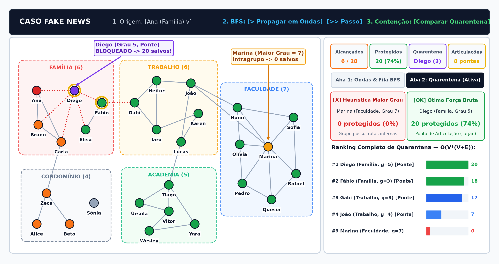
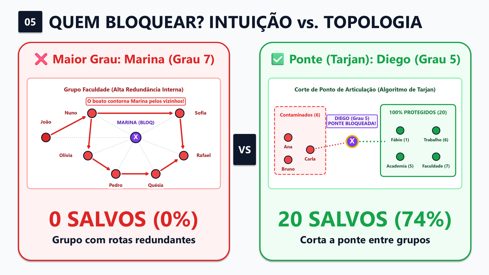
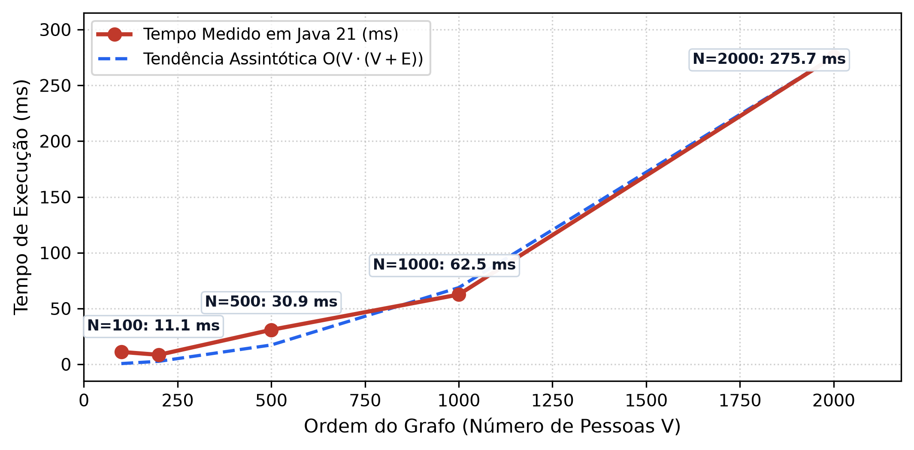

<div align="center">

# 🕸️ Caso Fake News — Propagação e Contenção em Redes Sociais com Grafos

**Modelagem Matemática, Algoritmos de Travessia (BFS/DFS), Pontos de Articulação de Tarjan e Quarentena Ótima em Java 21 Puro**

[](https://adoptium.net/)
[](./demo/src/br/maua/fakenews/algoritmos/)
[-16A34A?style=for-the-badge)](./demo/)
[](https://maua.br/)

<br/>



<p align="center">
  <em>Arquitetura <b>"O Java 21 pensa, o navegador desenha"</b>: motor algorítmico 100% em Java 21 com <code>HttpServer</code> nativo e visualização interativa em SVG/HTML5 com relaxamento anticolisão.</em>
</p>

</div>

---

## 📌 Sobre o Projeto

Este repositório reúne a pesquisa teórica, a modelagem matemática e a ferramenta computacional desenvolvidas para a disciplina **ECM306 — Tópicos Avançados de Estrutura de Dados** do **Instituto Mauá de Tecnologia (IMT)**.

Em vez de abordar aplicações tradicionais de rotas de GPS, o projeto investiga um problema contemporâneo crítico: **como a topologia de uma rede de mensagens instantâneas governa a velocidade de difusão de um boato (*fake news*) e qual indivíduo deve ser colocado preventivamente em quarentena para minimizar a contaminação global**.

### 🎯 Principais Descobertas Experimentais
1. **Popularidade local não equivale a importância estrutural:** Bloquear a pessoa mais conectada da rede (**Marina**, grau $7$, grupo *Faculdade*) protege **exatamente $0$ pessoas adicionais ($0\%$)**, pois seu grupo possui rotas internas redundantes (ciclos) que contornam o bloqueio.
2. **Pontos de Articulação dominam a contenção:** Bloquear **Diego** (grau $5$) ou **Fábio** (grau $3$) — identificados em tempo linear $\mathcal{O}(|V| + |E|)$ pelo **Algoritmo de Tarjan** como *Pontos de Articulação* (pontes estruturais) — interrompe a transição entre grupos e salva até **$20$ pessoas ($74,1\%$ da rede contaminada)**.
3. **Escalabilidade em Java 21:** Mesmo o algoritmo exato de Quarentena por Força Bruta $\mathcal{O}(|V| \cdot (|V| + |E|))$ analisa redes comunitárias sintéticas de **$2.000$ vértices e $4.433$ arestas em apenas $275,7\text{ ms}$ ($< 0,3\text{ s}$)**.

---

## 📦 Entregáveis Oficiais (Pasta [`Entrega/`](./Entrega/))

| Artefato | Arquivo | Descrição |
| :--- | :--- | :--- |
| 📄 **Relatório Científico (PDF)** | [`Entrega/Relatorio_Grafos_e_suas_Aplicacoes.pdf`](./Entrega/Relatorio_Grafos_e_suas_Aplicacoes.pdf) | Artigo completo em padrão ABNT (**10 páginas**): fundamentos, Lema do Aperto de Mãos, Lista vs. Matriz de Adjacência, Trilhas Eulerianas vs. Ciclos Hamiltonianos, Grafos Bipartidos e Teorema de Hall, Planaridade (Kuratowski) e Coloração, BFS, DFS, Tarjan, 7 aplicações reais no cotidiano e estudo de caso experimental. |
| 📊 **Apresentação Executiva (PPTX)** | [`Entrega/Apresentacao_Caso_Fake_News.pptx`](./Entrega/Apresentacao_Caso_Fake_News.pptx) | Apresentação widescreen (16:9) em **6 slides** de alto impacto visual (*"Mostre o Grafo, Não Descreva o Grafo"*), com diagramas em 300 DPI, animações progressivas *On Click*, transições suaves e notas do orador cronometradas para 5 minutos. |
| 💻 **Aplicação Interativa (Java 21)** | [`demo/`](./demo/) e [`demo/fakenews.jar`](./demo/fakenews.jar) | Sistema completo em **Java 21 puro** (zero bibliotecas externas) com API REST nativa, interface web interativa em duas abas, modo console (CLI) e suíte de 12 testes automatizados. |

---

## 🧠 Modelagem em Grafo (As 5 Perguntas de Projeto)

Seguindo a metodologia de modelagem da disciplina (Aula T25), o problema foi estruturado como um grafo simples $G = (V, E)$:

1. **Quem são os vértices ($V$)?**
   Cada vértice representa um usuário cadastrado ([`pessoas.csv`](./demo/dados/pessoas.csv)). A rede principal possui $|V| = 28$ pessoas divididas em **5 grupos comunitários**:
   * 🔴 **Família** ($6$ membros: `Ana`, `Bruno`, `Carla`, `Diego`, `Elisa`, `Fábio`)
   * 🟡 **Trabalho** ($6$ membros: `Gabi`, `Heitor`, `Iara`, `João`, `Karen`, `Lucas`)
   * 🔵 **Faculdade** ($7$ membros: `Marina`, `Nuno`, `Olívia`, `Pedro`, `Quésia`, `Rafael`, `Sofia`)
   * 🟢 **Academia** ($5$ membros: `Tiago`, `Úrsula`, `Vitor`, `Wesley`, `Yara`)
   * ⚪ **Condomínio** ($4$ membros: `Zeca`, `Alice`, `Beto` e o vértice isolado `Sônia`, grau $0$)
2. **Quem são as arestas ($E$)?**
   Cada aresta $\{u, v\}$ representa um canal de contato direto mútuo ([`contatos.csv`](./demo/dados/contatos.csv)), totalizando $|E| = 42$ conexões ativas.
3. **Direcionado ou Não Direcionado?**
   **Não direcionado**, pois a conversa direta entre dois contatos permite encaminhamento recíproco ($u \leftrightarrow v$).
4. **Ponderado ou Não Ponderado?**
   **Não ponderado**: cada repasse equivale a $1$ salto discreto ($1$ onda de transmissão).
5. **Estrutura de Dados e Algoritmos:**
   Representação em **Lista de Adjacência** ($\mathcal{O}(|V| + |E|)$ em memória na classe [`Grafo`](./demo/src/br/maua/fakenews/modelo/Grafo.java)), combinando:
   * **Busca em Largura (BFS — $\mathcal{O}(|V| + |E|)$):** Simulação das ondas concêntricas de contágio por fila FIFO e árvore de caminhos mínimos ([`BuscaEmLargura.java`](./demo/src/br/maua/fakenews/algoritmos/BuscaEmLargura.java)).
   * **Quarentena Exata por Força Bruta ($\mathcal{O}(|V| \cdot (|V| + |E|))$):** Remoção temporária de cada candidato elegível $v \in V \setminus \{s\}$ seguida de BFS para medir a redução exata do contágio ([`Quarentena.java`](./demo/src/br/maua/fakenews/algoritmos/Quarentena.java)).
   * **Pontos de Articulação de Tarjan ($\mathcal{O}(|V| + |E|)$):** DFS iterativa com vetores `disc[u]` e `low[u]` para identificar vértices de corte sem risco de `StackOverflowError` ([`PontosDeArticulacao.java`](./demo/src/br/maua/fakenews/algoritmos/PontosDeArticulacao.java)).

---

## 📊 Resultados Experimentais: Intuição Gulosa vs. Topologia Global

Iniciando o boato na Paciente Zero **Ana (`id 0`, Família)** sem bloqueios, a BFS contamina **$27$ das $28$ pessoas ao longo de $9$ ondas** (apenas **Sônia**, grau $0$, permanece inalcançável).

Para conter preventivamente o boato bloqueando um único indivíduo $v \in V \setminus \{s\}$, o ganho líquido de proteção é dado por:

$$\text{protegidos}(v) = |\text{alcançados}(G, s)| - |\text{alcançados}(G \setminus \{v\}, s)| - 1$$

| Rank | Candidato (ID) | Grupo | Grau $d(v)$ | Pessoas Salvas | Ponto de Articulação (Tarjan) | Diagnóstico Topológico |
| :---: | :--- | :---: | :---: | :---: | :---: | :--- |
| **#1** | **Diego (`id 3`)** | Família | $5$ | **20 (74,1%)** | ✅ Sim (Ponte) | **Ótimo Global:** isola Elisa, Fábio e 3 grupos inteiros (Trabalho, Faculdade e Academia) |
| **#2** | **Fábio (`id 5`)** | Família | $3$ | **18 (66,7%)** | ✅ Sim (Ponte) | Ponte exclusiva entre Família e Trabalho |
| **#3** | **Gabi (`id 6`)** | Trabalho | $3$ | **17 (63,0%)** | ✅ Sim (Ponte) | Porta de entrada única do grupo Trabalho |
| **#4** | **João (`id 9`)** | Trabalho | $4$ | **7 (25,9%)** | ✅ Sim (Ponte) | Ponte única entre Trabalho e Faculdade |
| **#5** | **Lucas (`id 11`)** | Trabalho | $3$ | **5 (18,5%)** | ✅ Sim (Ponte) | Ponte única entre Trabalho e Academia |
| ... | ... | ... | ... | ... | ... | ... |
| **#9** | **Marina (`id 12`)** | Faculdade | **7 (Máx.)** | **0 (0,0%)** | ❌ Não | **Falha da Heurística de Maior Grau:** grupo possui ciclos internos redundantes |

<div align="center">
  
</div>

---

## 🚀 Como Executar a Demonstração

### Pré-requisitos
* **JDK 21 LTS** ou superior instalado e disponível no `PATH` (`java -version` e `javac -version`).
* Qualquer navegador moderno (Chrome, Edge, Firefox).

### 1. Executar a Interface Web Interativa (Recomendado)
No Windows, basta executar o script na pasta [`demo/`](./demo/):
```cmd
cd demo
executar.bat
```
> O script compila o código-fonte (caso `fakenews.jar` ainda não exista), inicia o servidor local em `http://localhost:8080/` e abre automaticamente o navegador.

**Roteiro rápido para demonstração em sala de aula:**
1. **Propagar BFS:** Com `Ana (Família)` selecionada como origem, clique em **`▶ Propagar em Ondas`** (ou **`⏭ Passo a Passo`**) para visualizar as $9$ ondas concêntricas e o rastreamento da fila FIFO na **Aba 1**.
2. **Comparar Quarentena:** Clique em **`🛡️ Comparar Quarentena`** para abrir a **Aba 2**, exibindo o confronto direto entre **Marina (Grau 7 → 0 salvos)** e **Diego (Grau 5, Ponte → 20 salvos)**.
3. **Testar Bloqueios no Grafo:** Use o seletor superior **`Cenário`** (ou clique com o **botão direito** sobre qualquer nó do grafo) para colocar/retirar pessoas de quarentena em tempo real e executar o **Benchmark $N = 100 \dots 2000$**.

### 2. Executar em Modo Console (CLI)
Para rodar toda a análise diretamente no terminal sem abrir o navegador:
```cmd
cd demo
java -Dfile.encoding=UTF-8 -jar fakenews.jar --console
```

### 3. Executar a Suíte de Testes Automatizados
A suíte [`TestesAlgoritmos.java`](./demo/test/br/maua/fakenews/TestesAlgoritmos.java) valida **12 casos unitários e de propriedade** (caminho $P_5$, ciclo $C_6$, grafo estrela, grafo desconexo, exemplo da Aula T25, validação da rede CSV, teste de estresse com $N=5.000$ vértices e equivalência de Tarjan contra força bruta em $200$ grafos aleatórios):
```cmd
cd demo
testar.bat
```

---

## 📈 Benchmark de Escalabilidade

<div align="center">
  
</div>

---

## 📂 Estrutura do Repositório

```text
Projeto Semestral/
├── Entrega/                                      # Artefatos finais prontos para avaliação
│   ├── Relatorio_Grafos_e_suas_Aplicacoes.pdf    # Artigo científico ABNT (10 páginas)
│   └── Apresentacao_Caso_Fake_News.pptx          # Apresentação executiva (6 slides, 16:9)
├── demo/                                         # Aplicação Java 21 ("O Java pensa, o navegador desenha")
│   ├── src/br/maua/fakenews/
│   │   ├── App.java                              # Ponto de entrada (Servidor Web + Modo Console)
│   │   ├── modelo/                               # Pessoa.java (record) e Grafo.java (Lista de Adjacência)
│   │   ├── algoritmos/                           # BuscaEmLargura.java, Quarentena.java, PontosDeArticulacao.java, ResultadoBFS.java
│   │   ├── dados/                                # LeitorCSV.java e GeradorDeRede.java (redes sintéticas)
│   │   └── web/                                  # ServidorWeb.java (HttpServer JDK) e Json.java
│   ├── test/br/maua/fakenews/
│   │   └── TestesAlgoritmos.java                 # 12 testes automatizados sem dependências externas
│   ├── dados/
│   │   ├── pessoas.csv                           # 28 vértices distribuídos em 5 grupos sociais
│   │   └── contatos.csv                          # 42 arestas de contato direto mútuo
│   ├── web/
│   │   ├── index.html                            # Layout interativo com 4 KPIs e 2 abas
│   │   ├── estilo.css                            # Estilização moderna e responsiva
│   │   └── app.js                                # Renderização SVG/HTML5 + algoritmo anticolisão
│   ├── compilar.bat                              # Compilação limpa e geração de fakenews.jar
│   ├── executar.bat                              # Inicialização da aplicação web
│   └── testar.bat                                # Execução da suíte de testes
└── documentos/                                   # Pipeline Python de geração documental e figuras (300 DPI)
    ├── comum/tema.py                             # Geração das figuras científicas (Kuratowski, BFS, UI, Benchmark)
    ├── relatorio/gerar_relatorio.py              # Compilador ReportLab do relatório PDF ABNT
    ├── apresentacao/gerar_apresentacao.py        # Compilador python-pptx dos slides e animações OpenXML
    └── requirements.txt                          # Dependências do pipeline documental
```

---

## 👥 Autores e Orientação

* **David Sanchez Bittencourt Daniel** — RA: `24.00029-9`
* **Kauã Bueno Marcatto Ortega** — RA: `24.00031-0`
* **Prof. Orientador:** Prof. Robson Calvetti
* **Instituição:** Instituto Mauá de Tecnologia (IMT) — Engenharia de Computação (2026)
