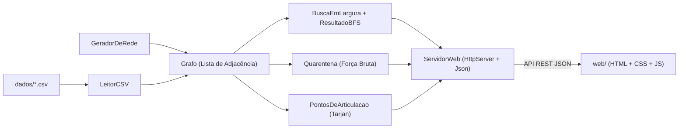

# Plano do Código (Backend Java + Frontend Web) — Revisão v1

> **Referência geral:** [`plano_geral.md`](file:///c:/Users/david/OneDrive/Documents/Faculdade/Tópicos%20Avançados%20de%20Estrutura%20de%20Dados/Projeto%20Semestral/plano/plano_geral.md)  
> **Princípio arquitetural:** *"O Java pensa, o navegador desenha"* — 100% da lógica de grafos, BFS, força bruta e pontos de articulação roda no servidor Java 21 nativo (`HttpServer`), enquanto o frontend HTML/CSS/JS apenas exibe e anima a rede.

---

## 1. Diagnóstico Crítico do Frontend na v0 ("Poluído e Pouco Intuitivo")

Ao analisar a captura de tela e o código da interface web na `v0` (`demo/web/`), identificamos exatamente por que a tela ficou poluída e difícil de usar:

1. **Nós (Polaroids) Gigantes e Sobrepostos:**
   - Na `v0`, cada nó era uma polaroid de `68×82 px` posicionada em círculos de raio muito curto (`~60 px`) para grupos de até 7 pessoas.
   - **Consequência:** As polaroids do mesmo grupo (`Família`, `Trabalho`, `Faculdade`, `Academia`, `Condomínio`) ficaram empilhadas umas por cima das outras, tampando os nomes (`Fábio`, `Bruno`, `Carla`, `Gabi`, `Marina`, `Tiago`), escondendo as arestas internas e dificultando o clique.
2. **Excesso de Botões e Modos Confusos na Barra Superior:**
   - Havia 8 controles espalhados em duas linhas, incluindo um botão `"Modo Quarentena: OFF"`. O usuário não sabia se clicar numa pessoa ia escolhê-la como *Paciente Zero* ou colocá-la em *Quarentena*, nem qual era a sequência natural de passos da demonstração.
3. **Painel Lateral ("Dossiê") Sobrecarregado:**
   - Mostrava simultaneamente 4 contadores, a tabela inteira da fila BFS, o alerta de heurística, a lista de ranking da força bruta, todas as tags de pontos de articulação e uma nota didática, tudo espremido numa única coluna com fonte pequena.
4. **Falta de Feedback Visual Direto no Grafo:**
   - Ao clicar em *"Analisar Quarentena"*, o resultado aparecia apenas como texto pequeno na barra lateral, sem destacar visualmente no grafo **quem é o Maior Grau (Marina)** vs. **quem é a Melhor Ponte (Diego/Fábio)**.

---

## 2. Redesign Completo do Frontend para a v1 ("Limpo, Espaçado e Intuitivo")

### 2.1. Layout do Grafo com Zero Sobreposição (Geometria + Anticolisão)
1. **Nós Compactos e Legíveis (Badges Investigativos Circulares `46×46 px`):**
   - Em vez de cartões retangulares grandes de `68×82 px`, cada pessoa será um **Nó Circular de Investigação (`46×46 px`)** com:
     - Borda colorida indicando o grupo (`Família`, `Trabalho`, `Faculdade`, `Academia`, `Condomínio`);
     - Iniciais em destaque no centro + pequeno *badge* numérico com o grau;
     - Etiqueta de nome (`pill`) logo abaixo com fundo contrastante para leitura imediata sem cobrir vizinhos;
     - Ícone/selo claro quando for **Paciente Zero (🎯)**, **Atingido na Onda $k$ (🔥 Onda $k$)** ou **Em Quarentena (🚫 BLOQUEADO)**.
2. **Demarcação Visual dos 5 Grupos ("Territórios") + Algoritmo Anticolisão:**
   - Desenhar no fundo do quadro 5 áreas suaves rotuladas (`FAMÍLIA`, `TRABALHO`, `FACULDADE`, `ACADEMIA`, `CONDOMÍNIO`), tornando imediatamente visível como os grupos se conectam por **poucas pontes**.
   - Aumentar o raio de distribuição de cada grupo e rodar um **passo determinístico de repulsão geométrica (relaxamento de forças)** após posicionar os nós, garantindo uma **distância mínima de `85 px` entre quaisquer dois centros**. **Resultado: zero sobreposição garantida em qualquer tamanho de tela.**
3. **Destaque de Conexões no Hover:**
   - Ao passar o mouse sobre qualquer pessoa, acender os fios conectados a ela, escurecer suavemente o restante e exibir um *tooltip* limpo (`Nome · Grupo · Grau · Status`).

### 2.2. Interação Direta e Fluxo Guiado em 3 Passos (Fim da Barra Poluída)
1. **Cabeçalho e Barra de Ações Unificados numa Única Faixa Compacta (`60 px` de altura):**
   - Libera mais área vertical para o grafo e organiza os controles em **3 passos numerados e intuitivos**:
     - **Passo 1 — Origem:** Seletor `Paciente Zero: [Ana (Família) ▾]`
     - **Passo 2 — Simular (BFS):** Botões `▶ Propagar em Ondas` · `⏭ Passo a Passo` · `↺ Limpar`
     - **Passo 3 — Contenção:** Botão `🛡️ Comparar Quarentena`
   - No canto direito, um único seletor discreto de cenário: `Cenário: [Rede Principal (28) ▾]` (com opções: *Rede Principal (28 pessoas)*, *Cenário Marina Bloqueada (Maior Grau)*, *Cenário Diego Bloqueado (Ótimo)* e *Rede Sintética (60 pessoas)* — perfeito para demonstrar ao vivo em 1 clique!).
2. **Interação Direta no Nó (Sem botão "Modo Quarentena: OFF"):**
   - **Clique esquerdo numa pessoa:** Seleciona como **Paciente Zero** (ou abre um mini-menu rápido com 2 botões: `🎯 Paciente Zero` | `🚫 Bloquear`).
   - **Clique direito numa pessoa (ou clique no botão `🚫` que aparece ao passar o mouse no nó):** Coloca ou retira a pessoa de **Quarentena** imediatamente e recalcula a propagação em tempo real!

### 2.3. Painel Lateral Organizado em 2 Abas Limpas (Fim do Dossiê Espremido)
O painel lateral terá **4 contadores grandes e coloridos no topo** (`Alcançados`, `Ondas BFS`, `Em Quarentena`, `Protegidos`) e, abaixo deles, **2 Abas alternáveis** (exibindo apenas uma coisa por vez, com fonte maior e limpa):

- **Aba 1 — `📡 Ondas & Fila BFS` (ativa durante a propagação):**
  - Mostra as **Ondas de Contágio** agrupadas visualmente por nível (`Onda 0`, `Onda 1`, `Onda 2`...) — clicáveis para destacar aquela onda no grafo;
  - Mostra a **Tabela de Rastreamento da Fila FIFO** (Aula T25: *Etapa · Fila Antes · Retirado · Novos*), limpa e legível.
- **Aba 2 — `🛡️ Quarentena & Pontos de Corte` (ativa automaticamente ao clicar em *Comparar Quarentena*):**
  - Exibe 2 cartões visuais lado a lado comparando:
    - **❌ Heurística Maior Grau (Marina, Grau 7):** `0 protegidos` — com botão `[Testar no Grafo]`;
    - **✅ Ótimo Força Bruta (Diego, Grau 5 — Ponte):** `20 protegidos (74%)` — com botão `[Aplicar Bloqueio]`;
  - Exibe o **Top 5 Candidatos da Força Bruta** com barra de progresso visual de pessoas protegidas e botão `[Bloquear]` em cada linha;
  - Inclui um botão/switch `Destacar Pontos de Articulação (Tarjan)` que ilumina com um anel dourado pulsante todas as pontes estruturais no grafo.

---

## 3. Arquitetura do Backend Java 21 (Mantida Sólida e Limpa)

A estrutura em Java puro (`demo/src/br/maua/fakenews/`) permanece desacoplada e sem dependências externas:

### Classes Java (`demo/src/br/maua/fakenews/`)
1. **`modelo/Pessoa.java`:** `record Pessoa(int id, String nome, String grupo)`.
2. **`modelo/Grafo.java`:** Lista de adjacência (`List<List<Integer>>`), grafo simples não direcionado e sem pesos, métodos `adicionarPessoa`, `adicionarContato`, `vizinhos`, `grau`, `numeroDeVertices`, `numeroDeArestas`.
3. **`algoritmos/BuscaEmLargura.java` + `ResultadoBFS.java`:**
   - Executa a BFS em $\mathcal{O}(V + E)$ ignorando vértices no conjunto `bloqueados`.
   - Retorna vetores `dist[]` e `anterior[]`, lista de ondas `niveis()`, lista de `PassoBFS(filaAntes, vertice, novos)` para a tabela da Aula T25, `alcancados()`, `naoAlcancados()` e `caminhoAte(v)`.
4. **`algoritmos/PontosDeArticulacao.java`:**
   - Algoritmo de Tarjan ($\mathcal{O}(V + E)$) em DFS iterativa (`disc[]`, `low[]`), identificando todas as pontes/vértices de corte da rede ativa (respeitando `bloqueados`).
5. **`algoritmos/Quarentena.java`:**
   - Força bruta exata em $\mathcal{O}(V \cdot (V + E))$: testa bloquear cada candidato $v$, roda a BFS e ordena o ranking por `protegidos` decrescente.
   - Compara o ótimo da força bruta com o candidato de **Maior Grau** e informa se a heurística acertou ou errou, além do tempo em milissegundos.
6. **`dados/LeitorCSV.java` e `dados/GeradorDeRede.java`:**
   - Lê `dados/pessoas.csv` (28 pessoas em 5 grupos, incluindo Sônia isolada e Marina com grau 7 intraclasse) e `dados/contatos.csv` (42 conexões).
   - Gera redes sintéticas reproduzíveis para o teste de escala ($N = 60$ na interface e $N = 100 \dots 2000$ no benchmark).
7. **`web/ServidorWeb.java` e `web/Json.java`:**
   - Servidor HTTP embutido (`com.sun.net.httpserver.HttpServer`) na porta `8080` servindo os arquivos estáticos de `web/` e as rotas `/api/rede`, `/api/bfs`, `/api/quarentena`, `/api/rede/aleatoria`, `/api/rede/original` e `/api/desempenho`.
8. **`App.java` e `test/br/maua/fakenews/TestesAlgoritmos.java`:**
   - Inicializa o servidor e abre o navegador automaticamente (com fallback `--console`).
   - Suíte de testes unitários cobrindo $P_5$, $C_6$, $K_{1,5}$, grafo desconexo, exemplo da Aula T25, validação do caso Marina vs. Diego na rede CSV e teste de propriedade de Tarjan contra força bruta em 200 grafos aleatórios.

---

## 4. Plano de Verificação do Código e Interface

1. **Testes Automatizados do Backend:**
   - Executar `compilar.bat` e `testar.bat` garantindo 100% de aprovação nos testes unitários.
2. **Inspeção Visual Automatizada do Novo Frontend:**
   - Subir o servidor (`java -jar fakenews.jar`) e capturar screenshots em `1920x1080` e `1366x768` usando Edge headless (`msedge --headless --screenshot`) nos 3 estados:
     1. Estado inicial (verificando que **nenhum dos 28 nós se sobrepõe** e que os 5 grupos estão claramente separados);
     2. Estado pós-propagação BFS (verificando as cores por onda e a Aba 1);
     3. Estado pós-análise de Quarentena (verificando o destaque visual de Marina vs. Diego no grafo e a Aba 2).
